# TC-12 — раунд 2026-11-03

**Кейс:** [TC-12](../../TC-12-CATALOG-STATES.md).

**Исполнитель:** независимый агент-тестировщик с Chrome DevTools MCP,
не исполнитель TASK-11 и не принимающий свой раунд.

**Окружение:** локальная release-сборка `http://localhost:8080/`, worktree
`/Users/pavelsmirnov/projects/yege_wars-TASK-11`, ветка `task/TASK-11`,
HEAD `ec9cdc422f027d8ecc636190ce0d1c6fa2f8c218`, тестовый Supabase
`yege_wars_dev`. Вход настоящим учеником через штатную кнопку «Тестовый вход»,
связанную в этой сборке с `TEST_LOGIN2_*`. Env, пароль и токены не читались.
Браузер — Chrome через Chrome DevTools MCP; изолированный контекст
`task11-states-20261103`; использованы только собственные страницы 2 и 3.

Desktop: 1440×900, DPR 1, mobile=false, touch=false, `navigator.platform`
`MacIntel`. Mobile: 360×800, DPR 1, mobile=true, touch=true,
`navigator.maxTouchPoints=1`, `navigator.platform='Linux armv8l'` установлен
до Flutter при каждой загрузке. Мобильный UA:
`Mozilla/5.0 (Linux; Android 13; Pixel 7) AppleWebKit/537.36 (KHTML, like Gecko) Chrome/142.0.0.0 Mobile Safari/537.36`.

Прогон выполнен 2026-11-03, снимки сохранены 16:03–16:10 Europe/Moscow.
Все PNG получены из ответа MCP, сохранены в `screenshots/` и каждый открыт
через `view_image`; ниже снимки расположены в порядке исполнения.

## Подмена и счётчики

Использован целиком исходный fetch-initScript TC-12. На mobile добавлено
только указанное переопределение platform в начале; при переходе к пустому
каталогу заменено только `mode: 'cards'` на `mode: 'empty'`. Каждый режим
установлен новой загрузкой документа (`reload` с `initScript`), не сменой hash.
Режимы ошибок не запускались. Карточки `tc-catalog-*` не открывались;
номер, сложность и поиск в режиме `cards` не менялись.

В `cards` это заданные клиенту фикстуры, не ответы базы: А и Б — №17,
В — №24, Г — без номера; сложности 1, 2, 3, 1; статистика А 50%, Б 0%,
В без попыток, у Г статистика отсутствует; попытки А неверная и верная,
Б неверная. В `empty` все четыре ответа — пустые массивы. Авторизация
оставалась настоящей. В состояние hook не сохранялись доступы или ответы задач.

Счётчики `calls` и `replaced` совпадали в каждой точке:

- Desktop `cards`, шаг 1: `{tasks:1, attempts:1, stats:1, numbers:1}`;
  после шага 6: `{tasks:7, attempts:7, stats:7, numbers:1}`.
- Desktop `empty`, шаг 7: `{tasks:1, attempts:1, stats:1, numbers:1}`;
  после шага 8: `{tasks:3, attempts:3, stats:3, numbers:1}`.
- Mobile `cards`, шаг 1: `{tasks:1, attempts:1, stats:1, numbers:1}`;
  после шага 6: `{tasks:7, attempts:7, stats:7, numbers:1}`.
- Mobile `empty`, шаг 7: `{tasks:1, attempts:1, stats:1, numbers:1}`;
  после шага 8: `{tasks:3, attempts:3, stats:3, numbers:1}`.

Все нужные маршруты перехвачены; нулевых счётчиков нет. Повторные запросы
при смене фильтров также подменены. Сетевые заголовки и тела настоящих
запросов не извлекались.

## Desktop — 1440×900

1. Каталог `cards` загрузился. Чипы ровно «№ 17» и «№ 24», повторов и чипа
   для null нет. Группы идут «Задание 17» (А, Б), «Задание 24» (В),
   «Без номера» (Г). Все четыре маршрута перехвачены. Совпало.

   

2. А: зелёная «Простая», галочка и зелёное «Решено», «Решили 50%».
   Б: оранжевая «Средняя», многоточие и «Есть попытки», «Решили 0%».
   В: красная «Сложная», метки прогресса нет, «Ещё никто не решал».
   Г: зелёная «Простая», метки прогресса нет, «Ещё никто не решал».
   Все карточки помещаются в viewport целиком, прокрутка для их осмотра
   не потребовалась. Совпало.

   

3. Выбрано «Решено»: только А под «Задание 17», чип выбран,
   «Сбросить фильтры» видна. Совпало.

   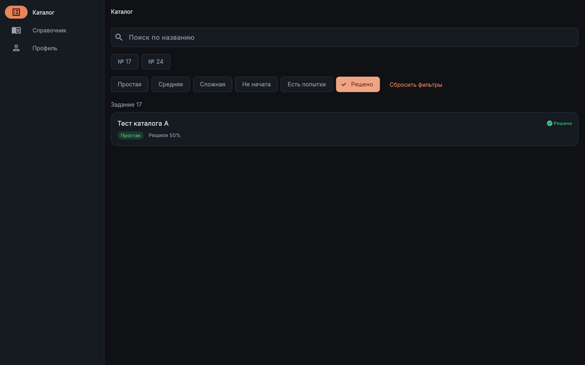

4. Без ручного снятия предыдущего условия выбрано «Есть попытки».
   «Решено» снят, осталась только Б в «Задание 17». Совпало.

   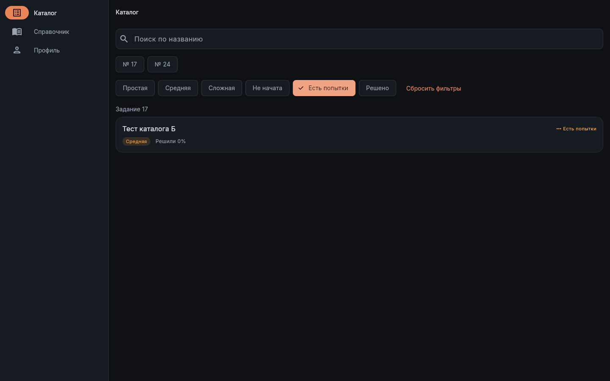

5. Выбрано «Не начата»: только В и Г в группах «Задание 24» и «Без номера».
   Метки «Не начата» на карточках нет, пустого «Задание 17» нет. Совпало.

   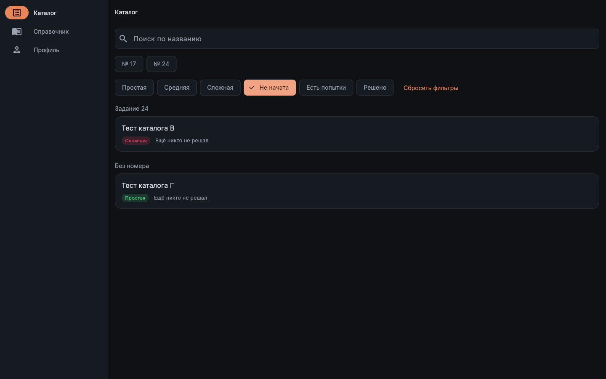

6. Повторное нажатие «Не начата» вернуло А, Б, В, Г в исходном порядке.
   Сброс скрыт, чипы прогресса сняты. Совпало.

   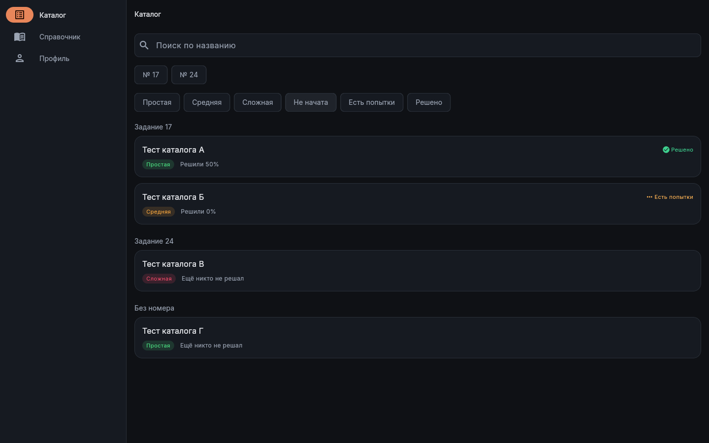

   Затем снова выбрано «Решено» (проверена только А), нажата
   «Сбросить фильтры»: все четыре карточки вернулись, все чипы прогресса
   сняты, сброс скрыт. Совпало.

   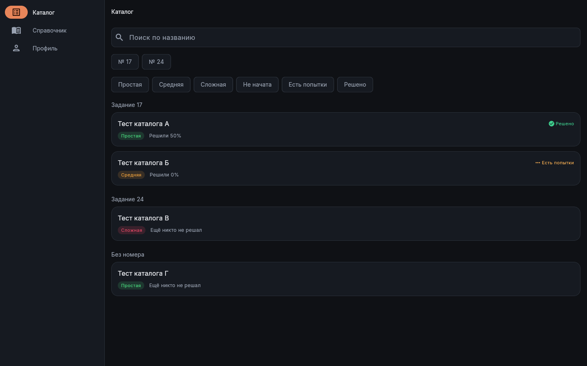

7. В той же вошедшей вкладке выполнен reload с `empty`. Все четыре ответа
   подменены пустыми массивами. Поиск пустой, выбранных чипов нет,
   «Задач пока нет». Номеров, групп, карточек, ошибки, «Повторить» и
   кнопки сброса нет. Совпало.

   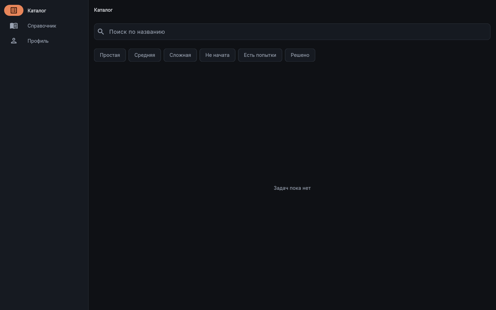

8. Выбрана «Сложная»: «По этим условиям задач нет», сброс виден. Совпало.

   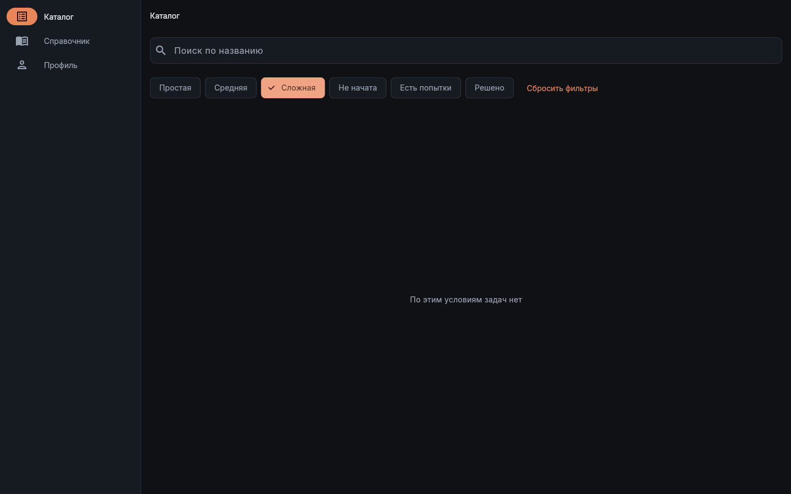

   Повторное нажатие «Сложная» сняло выбор: «Задач пока нет», сброс скрыт.
   Совпало.

   

## Mobile — 360×800

1. После reload с мобильной platform до Flutter все четыре маршрута
   перехвачены. Чипы ровно «№ 17», «№ 24». А, Б относятся к «Задание 17»,
   В — к «Задание 24»; последняя группа с Г подтверждена прокруткой
   на шаге 2. Чипы сложности и прогресса переносятся без наложений. Совпало.

   

2. А — «Простая», галочка и «Решено», «Решили 50%»;
   Б — «Средняя», многоточие и «Есть попытки», «Решили 0%»;
   В — «Сложная», без прогресса, «Ещё никто не решал». Совпало.

   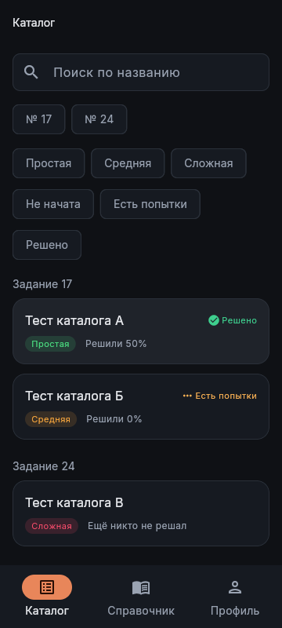

   Список прокручен вниз (`scrollTop=148`). Г находится последней в
   «Без номера»: «Простая», без метки прогресса, «Ещё никто не решал».
   В и Г полностью видны; нижняя навигация их не перекрывает. Совпало.

   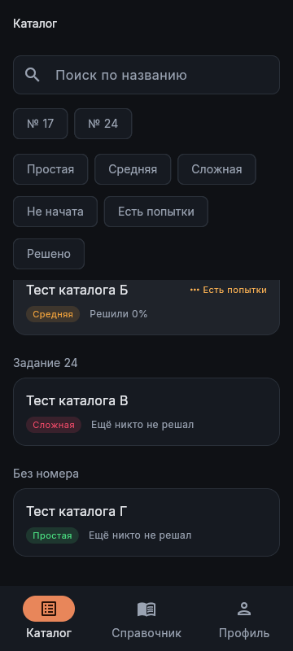

3. Выбрано «Решено»: только А в «Задание 17», выбранный чип и сброс видны.
   Совпало.

   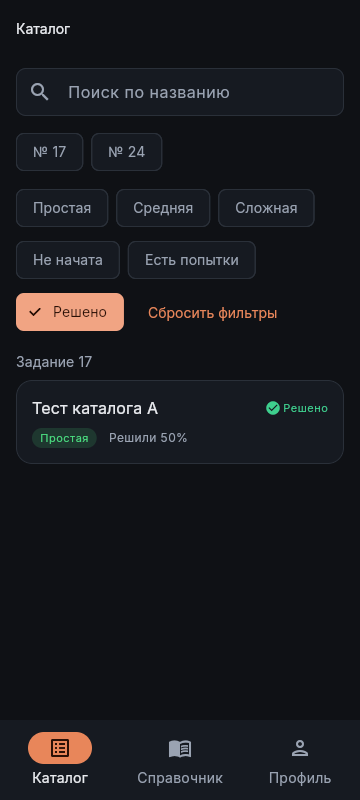

4. Выбрано «Есть попытки» без ручного снятия «Решено»: «Решено» снят,
   только Б в «Задание 17». Совпало.

   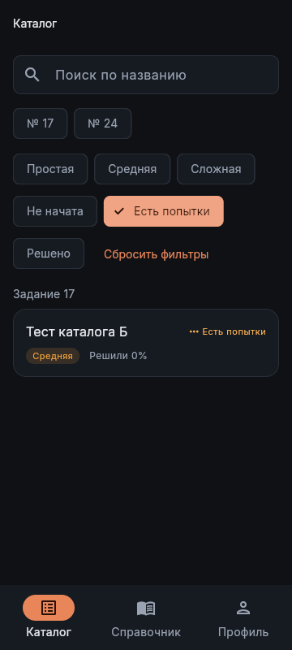

5. Выбрано «Не начата»: только В и Г, соответствующие две группы;
   пустых заголовков и метки «Не начата» на карточках нет. Совпало.

   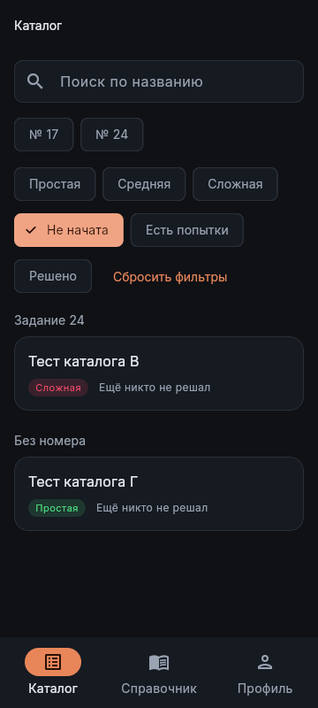

6. Повторное нажатие «Не начата» сняло отбор: в дереве снова А, Б, В, Г
   в исходном порядке, чипы сняты, сброс скрыт. Совпало.

   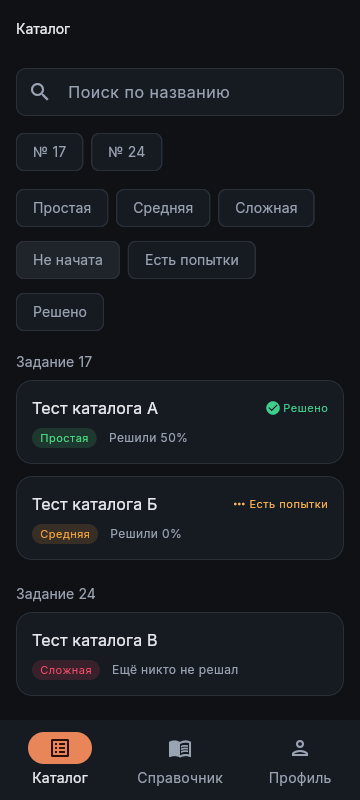

   Снова выбрано «Решено» (осталась А), затем «Сбросить фильтры»:
   все А–Г вернулись в исходном порядке, выбранных чипов прогресса и
   сброса нет. Г ниже текущего viewport, её исходное отображение проверено
   на снимке 13. Совпало.

   

7. В той же вошедшей вкладке reload с `empty` и мобильной platform
   до Flutter. Все четыре ответа подменены пустыми массивами.
   Поиск пустой, чипы сняты; «Задач пока нет». Номеров, карточек, групп,
   ошибок, «Повторить» и сброса нет. Совпало.

   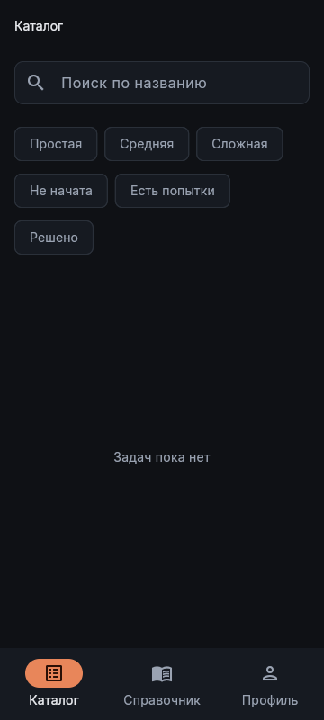

8. Выбрана «Сложная»: «По этим условиям задач нет», сброс виден. Совпало.

   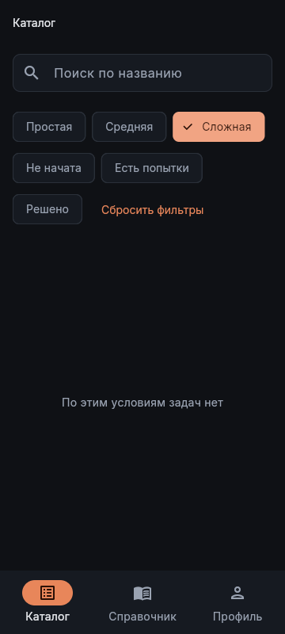

   Повторное нажатие сняло «Сложная»: «Задач пока нет», сброс скрыт.
   Совпало.

   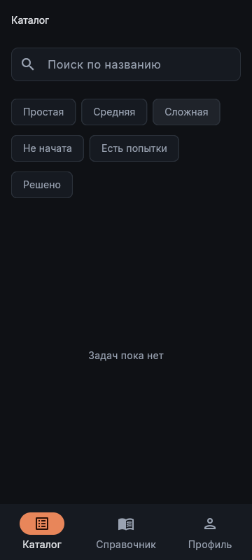

## Вид и активные области

Раскладка и тексты сверены с FIG-11; цвета сложности — зелёный,
оранжевый и красный; прогресса — зелёный и янтарный, графитовые поверхности
и оранжевый акцент соответствуют TOKEN-7 визуально. Текст и элементы
управления не обрезаются и не накладываются. На mobile вертикально
прокручивается список; обрезанная при промежуточной позиции верхняя карточка
на снимке 13 — естественная граница viewport списка. Горизонтального
скролла всей страницы нет; `document.documentElement.scrollWidth` не
превышает `innerWidth` на обеих ширинах.

Измерены `getBoundingClientRect()` именно `[flt-tappable]` semantics-узлов,
не только видимой заливки чипа. На desktop и mobile исходные размеры:

- «№ 17» — 67.23×48; «№ 24» — 70.98×48.
- «Простая» — 92.20×48; «Средняя» — 94×48; «Сложная» — 96.25×48.
- «Не начата» — 103.83×48; «Есть попытки» — 127.87×48;
  «Решено» — 87.92×48. На mobile дополнительно измерен выбранный
  «Решено» — 107.92×48.
- «Сбросить фильтры» — 161.39×48 на обеих ширинах.

Все ширины и высоты не ниже 44 логических px по TOKEN-6. На mobile
`elementFromPoint(rect.x+2, rect.y+2)` для всех восьми чипов и сброса
вернул соответствующий tappable-узел: область включает отступ у края.
Нажатия фильтров и сброса фактически изменяли состояние на обоих viewport.

## Завершение

Подменная страница 2 закрыта. В том же isolatedContext открыта отдельная
чистая страница 3 без `initScript`, подтверждено отсутствие собственного
`window.__catalogCase`. Настоящий каталог dev загрузился: реальные чипы
номеров и реальные названия задач, фикстур А–Г нет. Совпало.

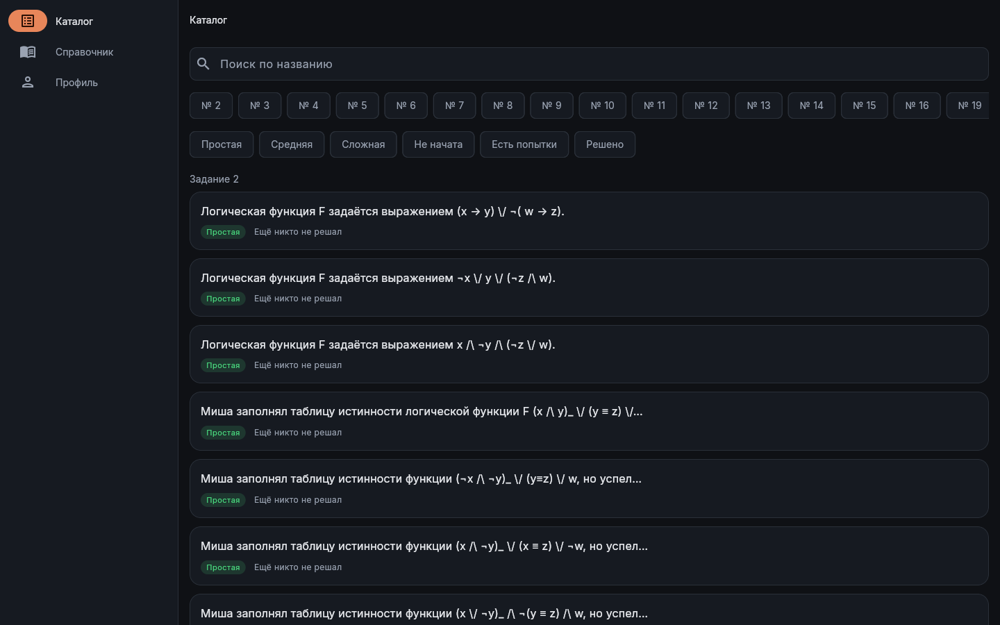

Чистая страница 3 также закрыта. Осталась исходная чужая `about:blank`,
она не изменялась. Сервер не останавливался. Код, кейсы, БД, конфигурация
и индексы не менялись; записан только собственный раунд. Коммитов нет.

## Отступления

- Предусловие TC-12 говорит `main`; в приёмке TASK-11 согласована сборка
  ветки задания. Фактически проверена указанная выше `task/TASK-11`
  на `ec9cdc4`, кейс не изменялся. Проверены ожидания TC-12 на принимаемой
  сборке, результат не выдаётся за отдельный прогон `main`.
- Ссылка TC-12 на viewport-правила obsolete TC-11 историческая;
  по указанию постановщика применены актуальные параметры mobile/touch,
  Android UA и platform до Flutter. Другие кейсы не прогонялись.
- На desktop нативное включение Flutter accessibility сначала завершилось
  timeout; безопасный аналог — click DOM-плейсхолдера — включил semantics.
  На mobile синтетические попытки включения не изменили UI; штатный click
  MCP по «Enable accessibility» включил semantics. Продуктовые фильтры
  после этого нажимались MCP по актуальным uid. Подмена и ожидания не менялись.
- На desktop все карточки шага 2 помещаются целиком, дополнительная
  прокрутка не нужна. На mobile сделан отдельный снимок после прокрутки
  для Г. Снимки получены из PNG-ответа MCP и сохранены локально, поскольку
  файловая система сервера MCP не является файловой системой worktree.

**Фактический результат:** все восемь шагов соответствуют ожиданиям на
1440×900 и 360×800. Каждый требуемый маршрут подменён, подтверждены
состояния всех четырёх карточек, прогресс, пустой каталог, тап-цели и cleanup.

**Вердикт:** PASS
